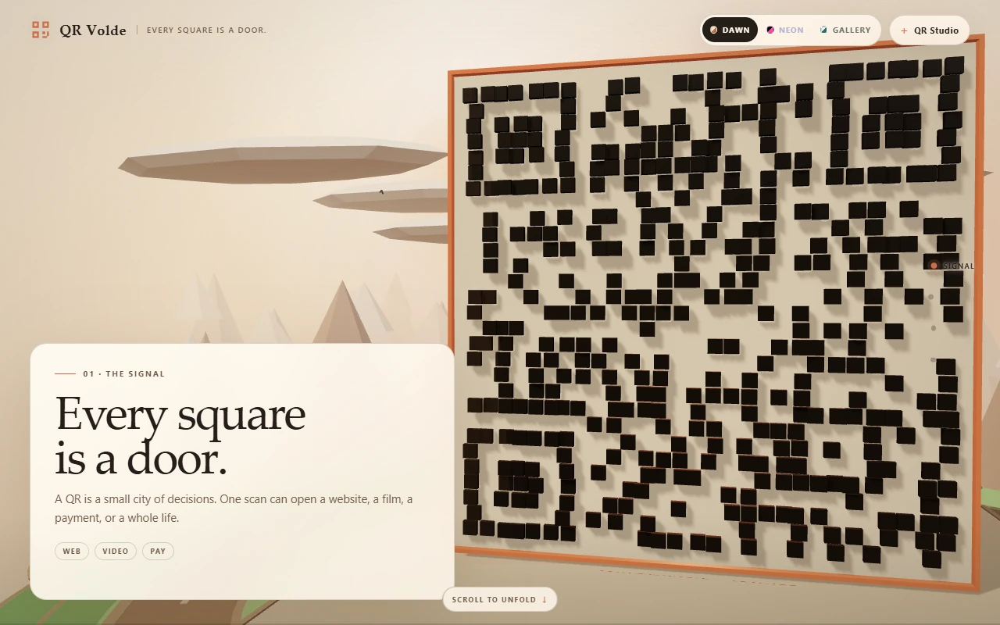
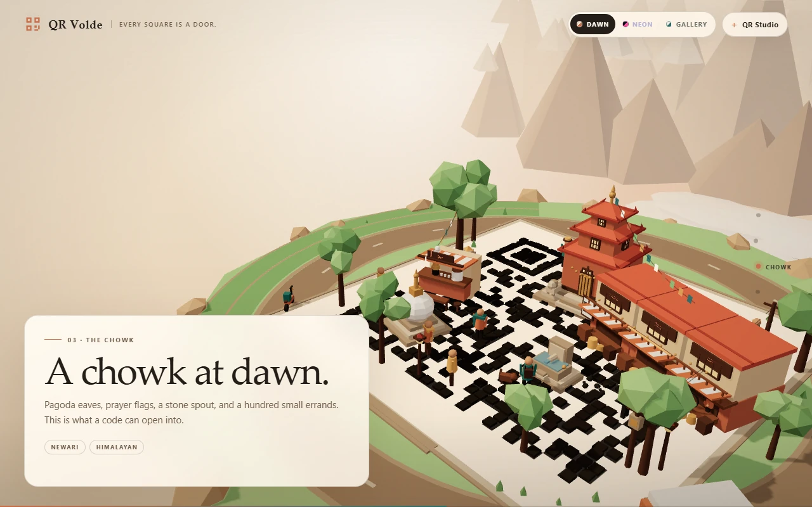
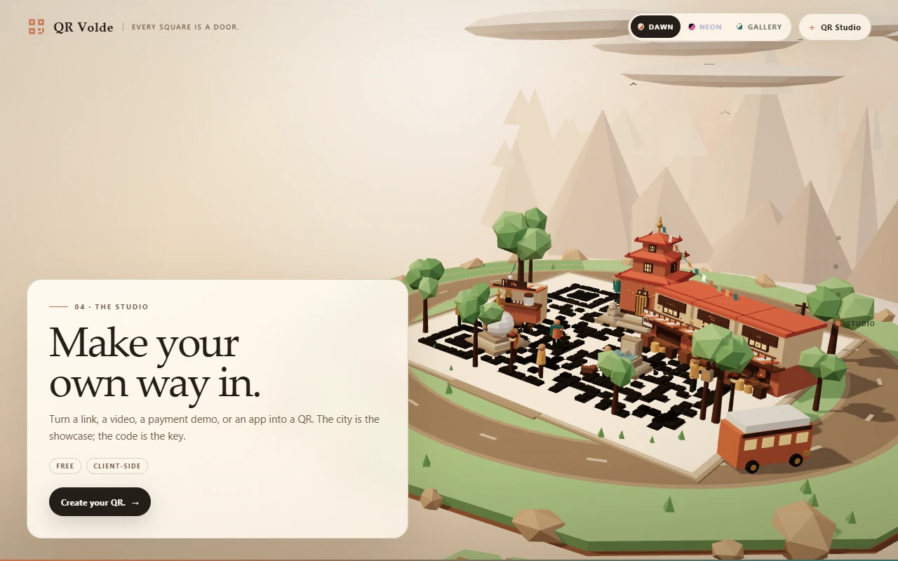
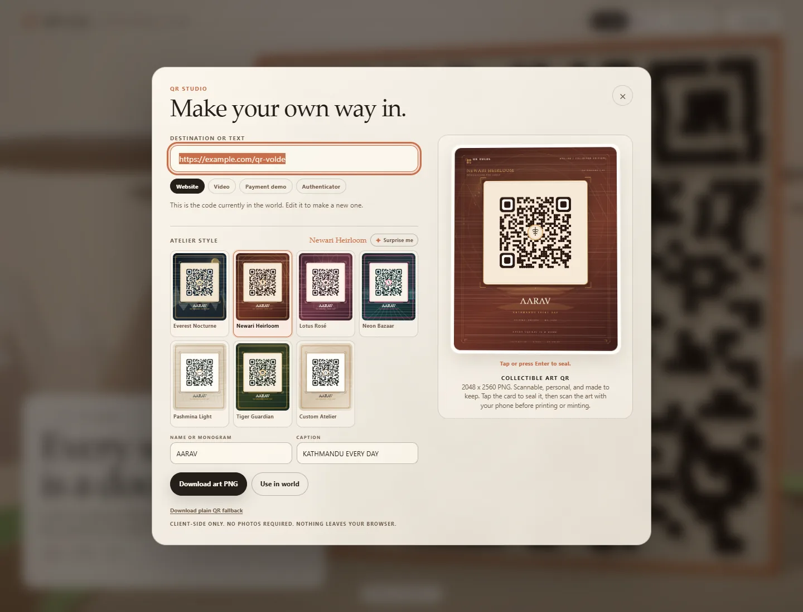
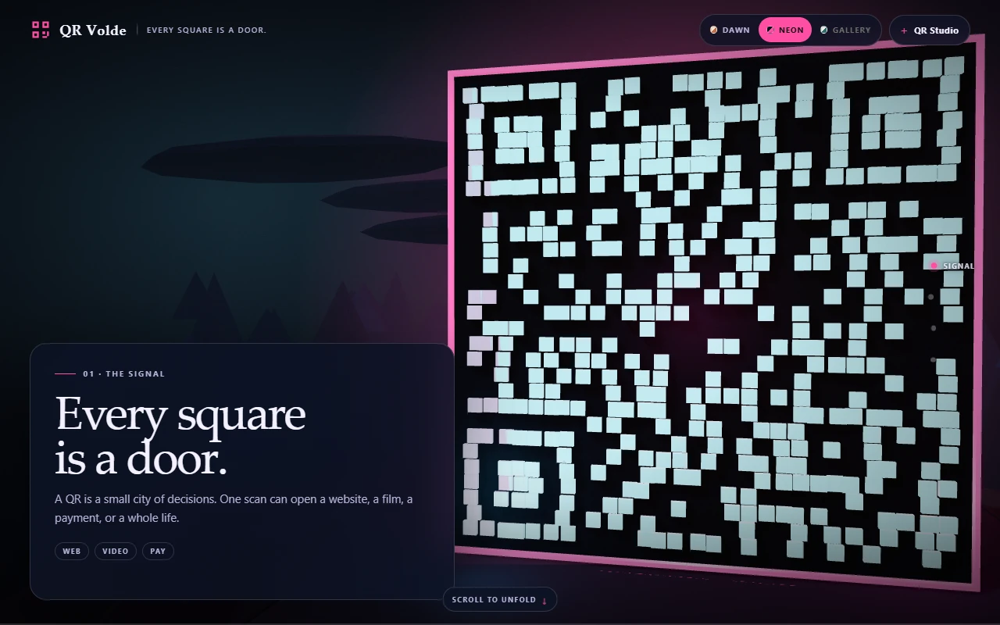
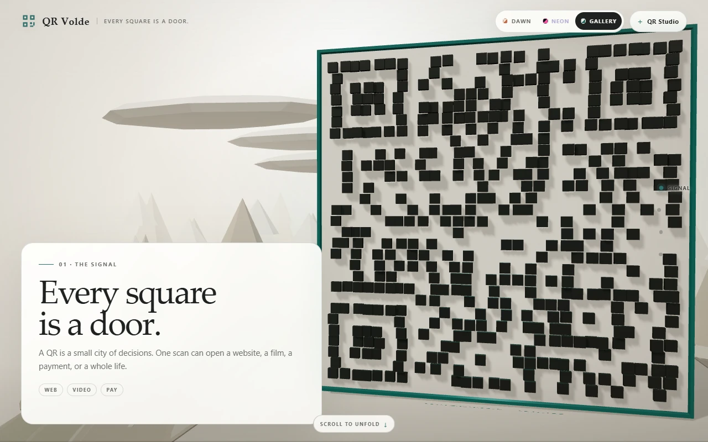
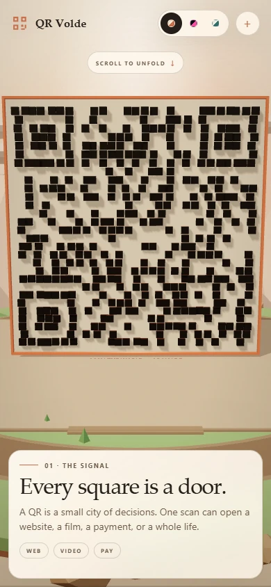
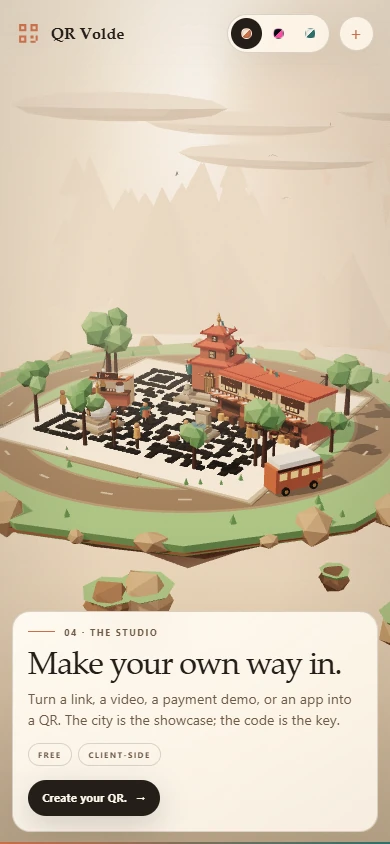

# QR Volde

**A giant 3D QR code that unfolds into a living Himalayan chowk.**

[Live demo](https://harmless-beep.github.io/qr-volde/) · [Release v0.1.0](https://github.com/harmless-beep/qr-volde/releases/tag/v0.1.0) · [Research notes](./RESEARCH.md) · [Changelog](./CHANGELOG.md)



## Overview

QR Volde is a scroll-driven 3D web experience. A dark-square QR monolith faces you, then breaks apart into a Kathmandu-style courtyard: a tiered pagoda, a shop row, a tea stall, a stone spout, a stupa, prayer flags, trees, people, a bus, a scooter, and the Himalayas behind it.

The 3D code is the artwork. The flat QR in **QR Studio** is the code you scan.

**Status:** v0.1.0 vertical slice, published 2026-10-27.  
**Built with:** Three.js r186 · `qrcode-generator` 2.0.4 · vanilla ES modules · Canvas 2D · GitHub Pages.  
**No build step, no backend, no analytics, no paid APIs.**

## Contents

- [Screenshots](#screenshots)
- [The experience](#the-experience)
- [QR Studio](#qr-studio)
- [Visual modes](#visual-modes)
- [Quick start](#quick-start)
- [How it works](#how-it-works)
- [Project structure](#project-structure)
- [Testing and QA](#testing-and-qa)
- [Deployment](#deployment)
- [Safety and privacy](#safety-and-privacy)
- [Roadmap](#roadmap)
- [Credits](#credits)
- [License](#license)

## Screenshots

### The journey

| The Signal | The Chowk |
|:--:|:--:|
|  |  |
| *The code is the door.* | *The code becomes a place.* |

| The Studio | QR Studio |
|:--:|:--:|
|  |  |
| *Make your own way in.* | *The flat code is the one to scan.* |

### Visual modes

| Himalayan Dawn | Neon Kathmandu | Minimal Gallery |
|:--:|:--:|:--:|
|  |  |  |
| *Warm brick, cream, and mountain haze.* | *Midnight blue, cyan modules, magenta signage.* | *Chalk, stone, charcoal, one teal accent.* |

### Mobile

<p align="center">
  
  
</p>

<p align="center"><em>Responsive framing, full-width copy, and a touch-friendly QR Studio.</em></p>

## The experience

Four scenes share one continuous camera flight:

1. **The Signal** — the QR monolith. Every square is a door.
2. **The Unfold** — modules lift from the wall and land as the city plan.
3. **The Chowk** — the block assembles: Newari roofs, brick, timber, tea steam, prayer flags, and small errands.
4. **The Studio** — make a QR for a link, video, payment demo, or app.

Scroll progress is weighted by scene, so the QR reveal and the city reveal each get room to breathe. The camera adapts to portrait, tablet, and wide screens instead of simply cropping the artwork.

## QR Studio

- Client-side QR generation. Nothing leaves the browser.
- Default payload: `https://example.com/qr-volde` (demo only).
- Presets: **Website** (also works for Google Sites), **Video**, **Payment demo**, **Authenticator**.
- **Use in world** updates the 3D matrix and the QR ground pattern.
- **Download PNG** exports a 512 × 512 high-contrast QR with a four-module quiet zone.
- Error correction: **Q (25%)**.
- UTF-8 / Devanagari input supported.
- Maximum input: 160 characters, so the 3D code stays readable.

> **The 3D QR is not a scanning target.** Use the flat preview or the downloaded PNG. Scan it with your phone before printing or sharing.

### Demo safety

- The payment preset is a URL demo, **not** a real bank or merchant QR.
- The authenticator preset is an educational link, **not** a TOTP secret.
- The project never asks for, collects, stores, or transmits an authenticator secret.
- For a real payment code, use your own merchant QR payload and follow your provider's guidance.

## Visual modes

- **Himalayan Dawn** — warm cream, terracotta, brick, and pale mountain haze.
- **Neon Kathmandu** — midnight blue, cyan modules, magenta signage, and wet-street glow.
- **Minimal Gallery** — chalk, stone, charcoal, and a single teal accent.

The mode persists in `localStorage` under `qrvolde-mode`. The QR Studio preview stays high-contrast black-on-cream in every mode; only the 3D artwork is themed.

## Quick start

Requires Python 3 for the included static server, or any static file server. There is no build step and no `npm install`.

```sh
git clone https://github.com/harmless-beep/qr-volde.git
cd qr-volde
npm run serve
# open http://127.0.0.1:4180/
```

Syntax check:

```sh
npm run check
```

Opening `index.html` directly with `file://` will not work because the app uses ES modules and an import map. Serve it over HTTP.

## How it works

- **One canvas, one scroll space.** A fixed WebGL canvas sits over a tall scroll spacer. Section weights map scroll progress to camera and reveal timing.
- **One QR matrix, three outputs.** `qrcode-generator` produces the matrix once. The same matrix drives the 3D module wall, the ground texture, and the flat Studio preview.
- **Instanced geometry.** The QR wall is built from instanced modules; the city is procedural low-poly geometry. No external models or image textures are loaded.
- **Wall-to-ground morph.** Modules lift, drift, and land as the QR plaza. City props fade in as the camera rises over the chowk.
- **Responsive camera.** Portrait screens pull back and lower the look target; wide screens shift the artwork to make room for the copy card.
- **Theme switching.** CSS custom properties re-theme the UI while Three.js palettes, materials, lights, and fog re-theme the scene.
- **Graceful fallback.** If WebGL is unavailable, the page shows a clear fallback and keeps QR Studio usable.
- **Reduced motion.** `prefers-reduced-motion` switches section changes to instant and keeps scene props static.

## Project structure

| Path | Role |
|---|---|
| `index.html` | Page shell, import map, copy overlay, mode switcher, QR Studio dialog. |
| `styles.css` | Layout, three visual themes, copy card, rail, Studio styling. |
| `world.js` | Boot, scroll progress, sections, modes, QR Studio orchestration. |
| `scene.js` | Camera path, section mapping, responsive framing, scene API. |
| `scene-world.js` | Renderer, palettes, materials, lights, island, mountains, clouds, sky. |
| `scene-qr.js` | QR monolith, wall-to-ground morph, ground texture, plaza. |
| `scene-city.js` | Road, city placement, reveal timing, people and flag animation. |
| `city-buildings.js` | Pagoda, shop row, tea stall, dhunge dhara, stupa, trees, signs. |
| `city-life.js` | People, dog, pigeons, bus, scooter, prayer flags, wires, lamps. |
| `qr.js` | QR generation, canvas rendering, PNG download, 3D texture drawing. |
| `vendor/` | Vendored Three.js r186 and `qrcode-generator` 2.0.4. |
| `docs/screenshots/` | README screenshots. |
| `RESEARCH.md` | References and design decisions. |
| `THIRD_PARTY_NOTICES.md` | Third-party licenses and MIT text. |
| `CHANGELOG.md` | Version history. |

## Testing and QA

- Lighthouse: **100 accessibility, 100 best practices, 100 SEO** (v0.1.0 local audit).
- Verified at **1280 × 800**, **785 × 932**, and **390 × 844**.
- Tested all three modes, real scrolling, rail navigation, CTA, QR generation, PNG download, “Use in world”, Devanagari input, invalid input, maximum length, reduced motion, and no-WebGL fallback.
- Downloaded QR checked for high contrast, finder patterns, and a four-module quiet zone.
- No console errors on the live site.

There is no automated visual-regression suite in v0.1. Scan the flat code with a physical phone before using it in print.

## Deployment

GitHub Pages serves the repository root from the `main` branch.

- Live: <https://harmless-beep.github.io/qr-volde/>
- `.nojekyll` keeps the static paths intact.
- Pushing to `main` triggers a new Pages build.
- No build step, environment variables, or secrets are required.

## Safety and privacy

- QR generation is entirely client-side.
- No accounts, backend, database, analytics, or tracking.
- No QR payload history is stored; only the selected visual mode is saved in `localStorage`.
- No real bank, merchant, wallet, or authenticator payloads are included.
- No stock images, photography, maps, external fonts, 3D models, or AI-generated assets are used. All geometry and Canvas textures are original procedural work.
- The city is a Kathmandu-inspired composition, not a survey-accurate reconstruction.

## Roadmap

- **v0.1** — Signal vertical slice: QR monolith, unfold, chowk, Studio. **Published.**
- **v0.2** — City: more streets, depth, and life.
- **v0.3** — Districts: switchable neighbourhoods and landmarks.
- **v0.4** — Launch: final brand copy, CTA destination, real demo payloads.
- **v1.0** — Stable release.

Open inputs for the next version: final tagline/brand copy, CTA destination, must-have landmarks, real QR payloads, and the license choice for the original code.

## Credits

Original code, procedural geometry, copy, and art direction: QR Volde project, 2026.

- Three.js r186 — MIT, Three.js Authors.
- `qrcode-generator` 2.0.4 and UTF-8 helper — MIT, Kazuhiko Arase.
- “QR Code” is a registered trademark of DENSO WAVE INCORPORATED.

Full notices and license text: [`THIRD_PARTY_NOTICES.md`](./THIRD_PARTY_NOTICES.md).  
Research references: [`RESEARCH.md`](./RESEARCH.md).

## License

Original QR Volde code and procedural art: **license TBD**. Third-party components remain under their respective MIT licenses; see [`THIRD_PARTY_NOTICES.md`](./THIRD_PARTY_NOTICES.md).
