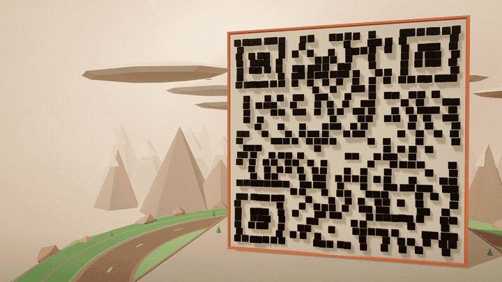
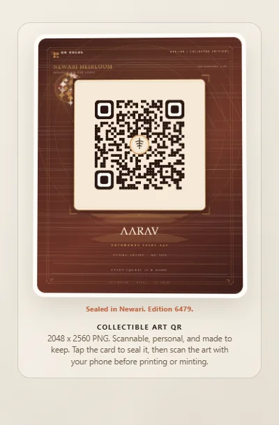
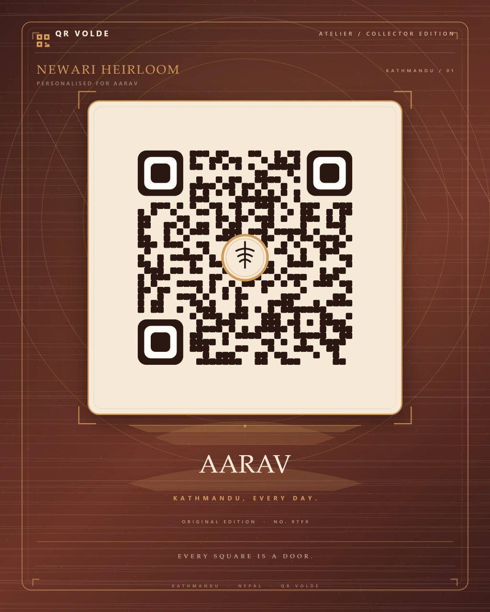
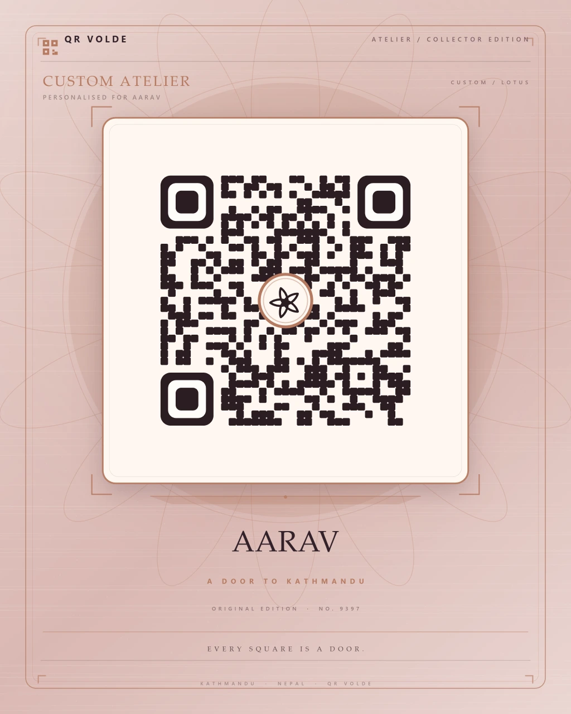
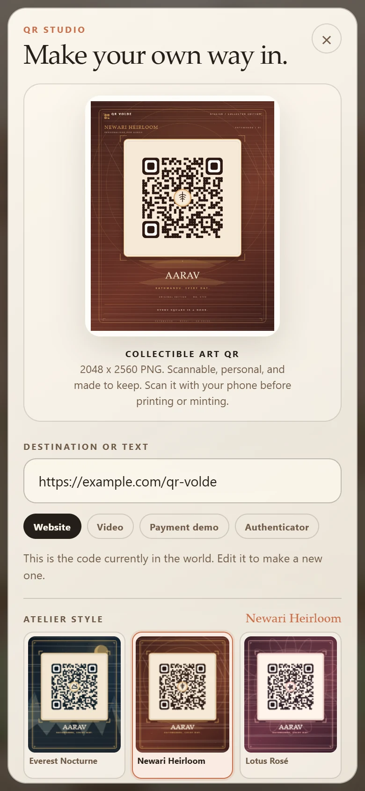

# QR Volde

**A giant 3D QR code that unfolds into a living Himalayan chowk.**

[Live demo](https://harmless-beep.github.io/qr-volde/) · [Release v0.3.0](https://github.com/harmless-beep/qr-volde/releases/tag/v0.3.0) · [Research notes](./RESEARCH.md) · [Changelog](./CHANGELOG.md)

[](https://harmless-beep.github.io/qr-volde/launch.html)

## Overview

QR Volde is a scroll-driven 3D web experience. A dark-square QR monolith faces you, then breaks apart into a Kathmandu-style courtyard: a tiered pagoda, a shop row, a tea stall, a stone spout, a stupa, prayer flags, trees, people, a bus, a scooter, and the Himalayas behind it.

The 3D code is the artwork. **QR Studio** turns the flat code into a collectible, scan-tested art card, or a plain fallback QR when a printer needs the simplest possible mark.

**Status:** v0.3.0 Living Atelier, published 2026-10-31.  
**Built with:** Three.js r186 · `qrcode-generator` 2.0.4 · vanilla ES modules · Canvas 2D · GitHub Pages.  
**No build step, no backend, no analytics, no paid APIs.**

## Launch film

The film loops above. It is made from real captures of the scroll experience and the QR Studio, and rendered with [HyperFrames](https://hyperframes.heygen.com). The 3D QR is the artwork; the flat Studio code is the one to scan.

[**Watch with sound →**](https://harmless-beep.github.io/qr-volde/launch.html) · [Download MP4](https://harmless-beep.github.io/qr-volde/launch-film/launch-film.mp4) · [Share copy](./launch-film/share-copy.md)

<sub>Music: Sascha Ende, ende.app (CC BY 4.0). Film source and render notes: [`launch-film/`](./launch-film/).</sub>

## Contents

- [Launch film](#launch-film)
- [Screenshots](#screenshots)
- [The experience](#the-experience)
- [QR Studio](#qr-studio)
- [QR Atelier](#qr-atelier)
- [Living Atelier](#living-atelier)
- [Visual modes](#visual-modes)
- [Quick start](#quick-start)
- [How it works](#how-it-works)
- [Project structure](#project-structure)
- [Testing and QA](#testing-and-qa)
- [Deployment](#deployment)
- [Safety and privacy](#safety-and-privacy)
- [Roadmap](#roadmap)
- [Credits](#credits)
- [License](#license)

## Screenshots

### The journey

| The Signal | The Chowk |
|:--:|:--:|
|  |  |
| *The code is the door.* | *The code becomes a place.* |

| The Studio | QR Studio |
|:--:|:--:|
|  |  |
| *Make your own way in.* | *The flat code becomes a collectible object.* |

### Living Atelier preview

<p align="center">
  
</p>

<p align="center"><em>Tap the card to seal it. Gold dust gathers at the panel edge so the code itself stays clear.</em></p>

### Atelier art

| Newari Heirloom | Custom Atelier |
|:--:|:--:|
|  |  |
| *A sample edition: AARAV, Kathmandu every day.* | *Custom palette, motif, name, and caption.* |

The art is generated locally from type, color, and procedural geometry. The QR stays on an opaque, high-contrast paper panel with a four-module quiet zone; the motifs live outside it, with only a small central seal over the data area.

### Mode gallery

| Himalayan Dawn | Neon Kathmandu | Minimal Gallery |
|:--:|:--:|:--:|
|  |  |  |
| *Warm brick, cream, and mountain haze.* | *Midnight blue, cyan modules, magenta signage.* | *Chalk, stone, charcoal, one teal accent.* |

### Mobile

<p align="center">
  
  
  
</p>

<p align="center"><em>Responsive framing, full-width copy, and a touch-friendly QR Studio with a collectible art preview.</em></p>

## The experience

Four scenes share one continuous camera flight:

1. **The Signal** — the QR monolith. Every square is a door.
2. **The Unfold** — modules lift from the wall and land as the city plan.
3. **The Chowk** — the block assembles: Newari roofs, brick, timber, tea steam, prayer flags, and small errands.
4. **The Studio** — make a QR for a link, video, payment demo, or app, then export it as a collectible art card.

Scroll progress is weighted by scene, so the QR reveal and the city reveal each get room to breathe. The camera adapts to portrait, tablet, and wide screens instead of simply cropping the artwork.

## QR Studio

- Client-side QR generation. Nothing leaves the browser.
- Default payload: `https://example.com/qr-volde` (demo only).
- Presets: **Website** (also works for Google Sites), **Video**, **Payment demo**, **Authenticator**.
- **Atelier style** picker: **Everest Nocturne**, **Newari Heirloom**, **Lotus Rosé**, **Neon Bazaar**, **Pashmina Light**, **Tiger Guardian**, and **Custom Atelier**.
- **Surprise me** picks a new finish: a different sample style, or the Custom Atelier with a new palette and motif. When Custom is already active it stays custom about half the time.
- **Living Atelier** preview: move the pointer for gold dust and a soft glow, tilt the card gently, then click, tap, or press **Enter** / **Space** to seal it. The hint answers with the style and edition code.
- Custom Atelier: name or monogram, caption, one of four palettes, and one of five procedural motifs. No photo upload is required.
- **Download art PNG** exports a **2048 x 2560** collectible card with a gallery plinth, deterministic edition number, and a four-module quiet zone.
- **Download plain QR fallback** exports a **1024 x 1024** high-contrast code.
- **Use in world** updates the 3D matrix and the QR ground pattern.
- Error correction: **H (30%)**. The same matrix drives the 3D wall, the ground texture, the art card, and the plain fallback.
- UTF-8 / Devanagari input supported.
- Maximum input: 160 characters, so the 3D code stays readable.
- The art PNG is a normal image suitable for printing or minting. No wallet, chain, marketplace, or on-chain uniqueness claim is built in; the edition code is a deterministic design detail.

> **The 3D QR is not a scanning target.** Use the Atelier preview, the downloaded art PNG, or the plain fallback. Scan it with your phone before printing or sharing.

## QR Atelier

The Atelier turns the scannable code into a small edition object: a paper panel, a gallery plinth, a style name, a personal inscription, and a deterministic edition number. Six sample styles are included, plus a custom style for names, palettes, and motifs.

### How the art stays scannable

- The QR is drawn on an **opaque paper panel** with a **four-module quiet zone**.
- Data modules are rounded, but the three finder patterns keep the nested **7 / 5 / 3** square silhouette scanners expect.
- Artwork and texture stay outside the panel; a **small central seal** is the only overlay on data modules.
- Error correction is **H (30%)**, so the central seal and the decorative panel have recovery room.
- Every sample and custom variant was decoded with a QR reader at **2048 x 2560** and at **640 x 800**.
- The **plain QR fallback** is available when a printer or older scanner needs the simplest possible code.

### Demo safety

- The payment preset is a URL demo, **not** a real bank or merchant QR.
- The authenticator preset is an educational link, **not** a TOTP secret.
- The project never asks for, collects, stores, or transmits an authenticator secret.
- For a real payment code, use your own merchant QR payload and follow your provider's guidance.

## Living Atelier

The v0.3 preview is a small playable object, not a static mockup. It is built with one extra Canvas 2D layer and no new dependencies.

- **Pointer gold dust.** Moving across the card releases small gold particles and a soft radial glow tinted by the current Atelier palette.
- **A gentle tilt.** The card leans up to 3° toward the pointer, with a short transition when the pointer leaves.
- **Seal it.** Click, tap, or press **Enter** / **Space** on the card. Two rings, a warm flash, and a particle burst answer the press, while the hint cycles through seal lines such as “Sealed in Newari. Edition 6479.”
- **The code stays clear.** The overlay knows the QR panel rectangle. Every frame it erases that rectangle, and when the pointer is over the panel the dust and glow project to the nearest panel edge instead of disappearing underneath it.
- **Surprise me.** The pill beside the style name randomizes the finish. With Custom Atelier active it keeps the custom style about half the time and chooses a different palette and motif; otherwise it switches to a different sample style.
- **Keyboard and touch.** The preview stage is a real `<button>` with a dynamic accessible label and an `aria-describedby` hint. Touch taps work the same as clicks.
- **Reduced motion.** `prefers-reduced-motion` disables particles, tilt, shuffle, and seal animations. The seal hint still updates, so the interaction remains understandable.
- **Preview only.** The overlay is a separate 640 x 800 canvas. It never touches the art canvas, so downloaded PNGs are byte-for-byte unchanged by the interaction.

## Visual modes

- **Himalayan Dawn** — warm cream, terracotta, brick, and pale mountain haze.
- **Neon Kathmandu** — midnight blue, cyan modules, magenta signage, and wet-street glow.
- **Minimal Gallery** — chalk, stone, charcoal, and a single teal accent.

The mode persists in `localStorage` under `qrvolde-mode`. The 3D artwork is themed by mode; Atelier palettes are independent and always keep the QR on a high-contrast paper panel.

## Quick start

Requires Python 3 for the included static server, or any static file server. There is no build step and no `npm install`.

```sh
git clone https://github.com/harmless-beep/qr-volde.git
cd qr-volde
npm run serve
# open http://127.0.0.1:4180/
```

Syntax check:

```sh
npm run check
```

Opening `index.html` directly with `file://` will not work because the app uses ES modules and an import map. Serve it over HTTP.

## How it works

- **One canvas, one scroll space.** A fixed WebGL canvas sits over a tall scroll spacer. Section weights map scroll progress to camera and reveal timing.
- **One QR matrix, four outputs.** `qrcode-generator` produces the matrix once. The same matrix drives the 3D module wall, the ground texture, the Atelier art card, and the plain fallback.
- **Instanced geometry.** The QR wall is built from instanced modules; the city is procedural low-poly geometry. No external models or image textures are loaded.
- **Wall-to-ground morph.** Modules lift, drift, and land as the QR plaza. City props fade in as the camera rises over the chowk.
- **Responsive camera.** Portrait screens pull back and lower the look target; wide screens shift the artwork to make room for the copy card.
- **Procedural Atelier.** A Canvas 2D renderer draws original motifs, paper texture, typography, and a gallery plinth around the high-contrast QR panel. No photos, external images, or fonts are loaded.
- **Living Atelier overlay.** A second 640 x 800 Canvas 2D layer draws pointer dust, glow, rings, and seal bursts. It is decorative only; the QR exclusion rectangle is cleared every frame, and the exported art canvas is never modified.
- **Theme switching.** CSS custom properties re-theme the UI while Three.js palettes, materials, lights, and fog re-theme the scene.
- **Graceful fallback.** If WebGL is unavailable, the page shows a clear fallback and keeps QR Studio usable.
- **Reduced motion.** `prefers-reduced-motion` switches section changes to instant and keeps scene props static.

## Project structure

| Path | Role |
|---|---|
| `index.html` | Page shell, import map, copy overlay, mode switcher, QR Studio dialog. |
| `styles.css` | Layout, three visual themes, copy card, rail, Studio styling. |
| `world.js` | Boot, scroll progress, sections, modes, QR Studio orchestration. |
| `scene.js` | Camera path, section mapping, responsive framing, scene API. |
| `scene-world.js` | Renderer, palettes, materials, lights, island, mountains, clouds, sky. |
| `scene-qr.js` | QR monolith, wall-to-ground morph, ground texture, plaza. |
| `scene-city.js` | Road, city placement, reveal timing, people and flag animation. |
| `city-buildings.js` | Pagoda, shop row, tea stall, dhunge dhara, stupa, trees, signs. |
| `city-life.js` | People, dog, pigeons, bus, scooter, prayer flags, wires, lamps. |
| `qr.js` | QR generation, canvas rendering, PNG download, 3D texture drawing. |
| `qr-art.js` | QR Atelier: six styles, custom palettes/motifs, and 2048 x 2560 art-card rendering. |
| `qr-play.js` | Living Atelier overlay: pointer dust, glow, tilt state, seal rings, edge projection, and reduced-motion guards. |
| `vendor/` | Vendored Three.js r186 and `qrcode-generator` 2.0.4. |
| `launch.html` | Launch-film page with the 20-second film, poster, share copy, and social links. |
| `launch-film/` | Launch-film plan, brief, editable HyperFrames composition, MP4, poster, and credits. |
| `docs/screenshots/` | README screenshots. |
| `RESEARCH.md` | References and design decisions. |
| `THIRD_PARTY_NOTICES.md` | Third-party licenses and MIT text. |
| `CHANGELOG.md` | Version history. |

## Testing and QA

- App Lighthouse: **100 accessibility, 100 best practices, 100 SEO** (v0.3.0 local audit).
- Launch-page Lighthouse: **100 accessibility, 100 best practices, 100 SEO** (local audit).
- Axe-core: **no violations** with QR Studio open at desktop and mobile widths.
- Verified at **1440 x 1100** and **390 x 844**. No horizontal overflow, no clipped Studio controls, and the preview stage stays inside the panel.
- Interaction QA: pointer dust and glow render outside the QR panel, the QR exclusion rectangle contains **zero overlay pixels**, tilt resets on pointer leave, keyboard **Enter** and **Space** both seal, touch tap seals, the hint cycles, and **Surprise me** kept Custom active 17 of 36 tries while producing 10 distinct palette/motif combinations.
- The export canvas was byte-for-byte identical before and after pointer movement and sealing.
- All six sample styles plus custom variants decoded with jsQR at **2048 x 2560** and **640 x 800**; the plain **1024 x 1024** fallback also decoded.
- Reduced motion: **zero** overlay pixels, no tilt, no seal/shuffle animation, and the seal hint still updates.
- No-WebGL: fallback is visible, QR Studio opens, the art preview renders, and the stage still seals.
- Tested all three visual modes, real scrolling, rail navigation, CTA, QR generation, style switching, custom palette/motif selection, name and caption personalization, art PNG download, plain fallback download, Use in world, Devanagari input, invalid input, maximum length, and long payloads.
- Downloaded art checked for finder patterns, a four-module quiet zone, opaque paper, and high contrast.
- Launch film checked at 20.0s, 1920x1080, 30fps, stereo AAC; key frames and transitions inspected.
- No console errors on the live site.

There is no automated visual-regression suite. Scan the flat art or plain fallback with a physical phone before using it in print.

## Deployment

GitHub Pages serves the repository root from the `main` branch.

- Live: <https://harmless-beep.github.io/qr-volde/>
- Launch film: <https://harmless-beep.github.io/qr-volde/launch.html>
- `.nojekyll` keeps the static paths intact.
- Pushing to `main` triggers a new Pages build.
- No build step, environment variables, or secrets are required.

## Safety and privacy

- QR generation is entirely client-side.
- No accounts, backend, database, analytics, or tracking.
- No QR payload history is stored. The selected visual mode and Atelier preferences are saved in `localStorage` under `qrvolde-mode` and `qrvolde-art`; payloads, names, and captions are not sent anywhere.
- No real bank, merchant, wallet, or authenticator payloads are included.
- The app uses no stock images, photography, maps, external fonts, 3D models, or AI-generated assets. All geometry, Atelier motifs, and Canvas textures are original procedural work.
- The Atelier never asks for a photo or file upload. Personalization is limited to text, palette, and motif.
- The launch film uses licensed music, SFX, and fonts; see [`THIRD_PARTY_NOTICES.md`](./THIRD_PARTY_NOTICES.md) and [`launch-film/README.md`](./launch-film/README.md).
- The city is a Kathmandu-inspired composition, not a survey-accurate reconstruction.

## Roadmap

- **v0.1** — Signal vertical slice: QR monolith, unfold, chowk, Studio. **Published.**
- **v0.2** — QR Atelier: six collectible art styles, custom palettes/motifs, and scan-tested 2048 x 2560 exports. **Published.**
- **v0.3** — Living Atelier: pointer gold dust, card tilt, seal ceremony, and **Surprise me**. **Published.**
- **v0.4** — City: more streets, depth, and life.
- **v0.5** — Districts: switchable neighbourhoods and landmarks.
- **v0.6** — Launch: final brand copy, CTA destination, real demo payloads.
- **v1.0** — Stable release.

Open inputs for the next version: final tagline/brand copy, CTA destination, must-have landmarks, real QR payloads, and the license choice for the original code.

## Credits

Original code, procedural geometry, copy, and art direction: QR Volde project, 2026.

- Launch film: HyperFrames (Apache-2.0); music by Sascha Ende, ende.app (CC BY 4.0); SFX under the Pixabay Content License; GSAP under the GSAP Standard License.

- Three.js r186 — MIT, Three.js Authors.
- `qrcode-generator` 2.0.4 and UTF-8 helper — MIT, Kazuhiko Arase.
- “QR Code” is a registered trademark of DENSO WAVE INCORPORATED.

Full notices and license text: [`THIRD_PARTY_NOTICES.md`](./THIRD_PARTY_NOTICES.md).  
Research references: [`RESEARCH.md`](./RESEARCH.md).

## License

Original QR Volde code and procedural art: **license TBD**. Third-party components and launch-film assets remain under their respective licenses; see [`THIRD_PARTY_NOTICES.md`](./THIRD_PARTY_NOTICES.md).
